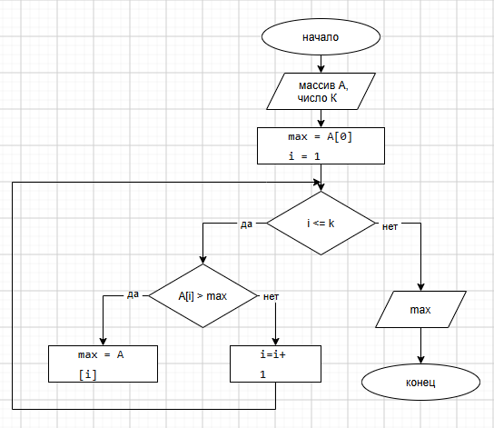

# Лабораторная работа №14
  
Студент: Полякова В.Д.
Группа: бТИИ-261

## Задание

Поиск максимального значения элемента массива, находящихся до заданной позиции K включительно.

**Требуется:**
1. Составить блок-схему алгоритма решения.
2. Написать программу на языке C.

## Блок-схема

